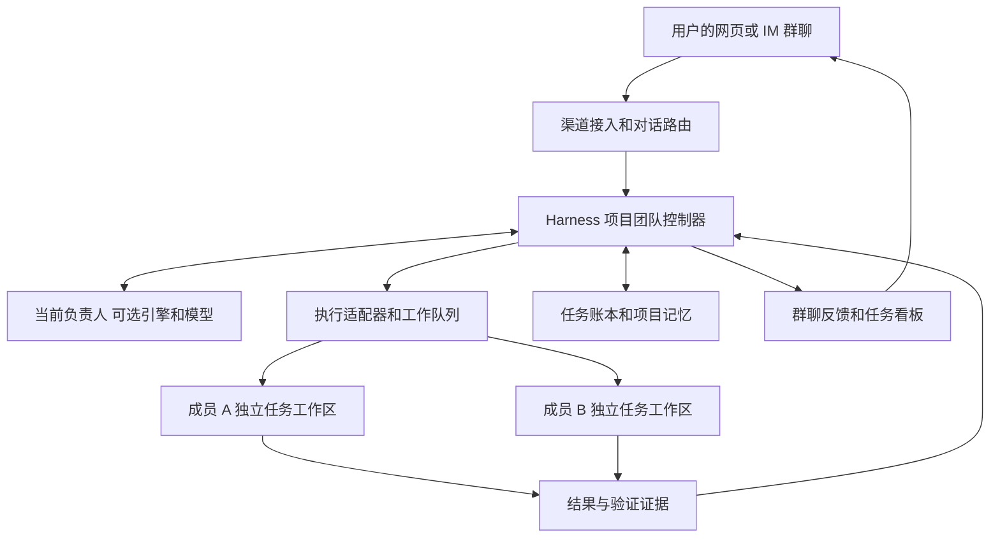

# DeepSeek Harness 多模型 Agent 团队完整实施方案

核验日期：2026年11月1日。用途：交给 Claude Code 或其他编码 Agent 审核、细化和实施。

**采用 DeepSeek Harness 作为运行底座，二次开发一个可配置的多 Agent 项目团队系统。** 用户在统一群聊入口交代需求，团队根据配置完成讨论、拆分、开发、测试、返工和反馈，自动携带项目背景、进度与偏好。

**角色、机器人身份、执行引擎、模型必须独立配置。** Claude Code 做负责人、Codex 做开发、DeepSeek 做测试只是一种示例，不能成为代码中的固定绑定。任何满足工具和运行能力要求的成员都可以担任负责人、开发、测试或自定义职责。

本方案覆盖完整目标和建设顺序。官方能力来自文档与公开代码审阅；本文提出的模块、接口、数据结构和验收指标属于待实施设计，尚未安装部署或进行端到端实测。

## 1 产品目标和配置原则

目标体验是一个长期存在的项目团队：能自然聊天，能在后台同时处理多项任务，能说明真实进展，能跨设备继续使用，换成员或换模型后仍能接上项目工作。

| 用户操作 | 目标行为 |
| --- | --- |
| 创建项目团队 | 绑定项目、一个或多个代码仓库、渠道、成员、默认负责人和权限 |
| 添加机器人 | 设置名称、职责说明、运行引擎、模型、工具、工作范围和渠道身份 |
| 调整分工 | 任意成员可被指定为负责人、开发、测试、审查、研究等；一人可兼任多项职责 |
| 选择模型 | 从该运行引擎实际支持且已配置的模型中选择；任务可覆盖成员默认选择 |
| 在群里说需求 | 路由到当前负责人，形成可追踪任务，不要求重复介绍项目 |
| 只聊天或问问题 | 直接交流；不把所有消息自动变成开发任务 |
| 中途改需求 | 修改任务版本，通知受影响成员，重新计算依赖与验收要求 |
| 手机问进度 | 查询同一服务端任务账本，不另起一套任务 |
| 切换执行端 | 保留项目与任务记录；根据能力恢复原生会话或带交接包重建 |

配置优先级采用：**任务显式覆盖 → 项目团队配置 → 机器人默认配置 → 系统默认值**。每次运行将解析后的有效配置固化在 Run 记录中，后续修改默认设置不悄悄改变已经运行的任务。该优先级适用于角色、模型和允许覆盖的运行参数；有效权限取系统、项目、账号、成员与任务限制的交集，任务覆盖不能扩大工具、目录或发布权限。

四个概念必须在产品和代码中分清：

- **Role**：做什么，例如负责决策、开发或测试。
- **Bot**：用户认识的长期成员，有名称、头像、偏好和权限。
- **Runtime**：由哪套 Agent 引擎执行，例如 Harness 内部 Agent、原生 Claude Code、原生 Codex。
- **Model**：运行引擎实际调用的模型及推理参数。

使用 Claude 模型的 Harness Agent，不等同于原生 Claude Code；调用 GPT 模型也不等同于原生 Codex。角色完全可选，但某个引擎能接哪些模型仍需依据真实能力清单，不能在界面上提供无法运行的组合。

每个项目主题同时只有一个有效协调负责人，用版本化的负责人任期记录控制权；负责人可以随时交接，不固定为某个品牌或模型。不同项目、不同独立工作单可以拥有不同负责人。

## 2 开源参考和实际采用边界

| 来源 | 已核验的能力或边界 | 本项目采用方式 |
| --- | --- | --- |
| DeepSeek Harness | 插件式运行时，提供模型、工具、Session 和子 Agent 等扩展面 | 固定技术底座，通过独立 Bundle 和插件扩展 [S1](https://github.com/deepseek-ai/deepseek-harness)[S3](https://deepseek-harness.github.io/deepseek-harness/en/reference/subsystems/subagent) |
| 官方 dsh-superagent-prototype | 面向单仓库的研究原型，支持 GitHub、可选飞书、工作票据和原会话反馈 | 二开事件接入、票据、执行与回传，扩展多项目、多仓库和团队配置 [S2](https://github.com/deepseek-ai/dsh-superagent-prototype) |
| Super-agent 持久执行机制 | 单写者 Engine、SQLite、持久 Effects、Outbox 和恢复设计 | 作为业务调度和可靠消息的主要代码参考 [S4](https://github.com/deepseek-ai/dsh-superagent-prototype/blob/main/docs/007-architecture.md) |
| Harness Agent Teams | 实验性的成员名单、直接消息、任务依赖和版本检查；当前为单进程共享目录 | 借鉴协作模型；不作为跨原生运行器、隔离工作区的现成团队系统 [S5](https://github.com/deepseek-ai/deepseek-harness/blob/master/packages/experimental/agent-team/README.md) |
| Harness Claude Code 和 Codex 适配器 | 真实原生执行，但当前按单次任务新建会话，不提供本需求的持续会话与完整进度流 | 保留简单委派用途；另建持久原生适配器 [S6](https://github.com/deepseek-ai/deepseek-harness/blob/master/packages/subagent/subagent-claude-code/README.md)[S7](https://github.com/deepseek-ai/deepseek-harness/blob/master/packages/subagent/subagent-codex/README.md) |
| Cindy | 有机器人与渠道绑定、Orca Worker 协作及独立群聊机制；公开仓库不包含后端服务 | 借鉴身份分层、队列、Worker 生命周期；不依赖未公开后端 [S8](https://github.com/makecindy/cindy)[S9](https://github.com/makecindy/cindy/blob/main/docs/product-rules/cindy-bots-runtime.md)[S10](https://github.com/makecindy/cindy/blob/main/docs/dev-rules/orca-team-architecture.md)[S11](https://github.com/makecindy/cindy/blob/main/docs/product-rules/bot-group-chat.md) |
| Grok Bot | 普通群消息、点名、回复与任务交接可作为交互参照 | 定义聊天体验目标，不能据此声称已经复现其流畅度 [S12](https://docs.x.ai/grok-bot/chat-and-collaboration) |
| Grok Build | 官方开源编码运行器，与 Grok Bot 是不同范围的产品 | 可参考原生执行器接入；不当作 Grok Bot 群聊后台源码 [S13](https://github.com/xai-org/grok-build) |
| OpenClaw | 群消息路由和 Bot 往返控制有公开设计 | 借鉴发言门控和防循环，避免再引入第二套主调度器 [S14](https://docs.openclaw.ai/channels/groups)[S15](https://docs.openclaw.ai/channels/bot-loop-protection) |
| Happy Agent | 区分自身 Agent 循环和接入完整原生 Agent 的路径 | 借鉴原生引擎桥接边界，不替换 Harness 底座 [S16](https://github.com/slopus/happy-agent) |

Harness Agent Teams 当前的共享工作目录、文件锁缺失、任务所有权不自动释放等限制，意味着“打开团队功能”不能直接覆盖本方案。其成员创建工具也不能被假定为已经提供本方案所需的任意模型与独立工作目录配置，需根据锁定版本扩展。[S5](https://github.com/deepseek-ai/deepseek-harness/blob/master/packages/experimental/agent-team/README.md)

Super-agent 的公开 README 明确说明部分文章设计没有实现。本方案以可读的公开仓库及源码文档为依据，不把研究文章中的目标当成交付承诺。[S2](https://github.com/deepseek-ai/dsh-superagent-prototype)

许可按最终采用文件逐项核对。Harness 和 Super-agent 仓库标注 MIT；Cindy 和 Grok Build 标注 Apache-2.0。原生运行器、模型服务、可选托管和第三方依赖仍有各自的使用条件，开源外围软件不等于模型调用免费。[S1](https://github.com/deepseek-ai/deepseek-harness)[S2](https://github.com/deepseek-ai/dsh-superagent-prototype)[S8](https://github.com/makecindy/cindy)[S13](https://github.com/xai-org/grok-build)

## 3 总体架构和控制权



**负责人负责判断，控制器负责可靠执行。**

负责人理解需求、提出任务拆分、解释取舍和组织验收。控制器依据已保存的规则验证调用者身份、创建任务、执行依赖、限制并发、持久化结果和恢复工作。控制器是确定性业务服务，不额外引入一个与负责人争夺决策权的模型。

负责人通过受控工具调用 create_task、assign_task、read_project_context、get_task_status、record_decision 等能力。群里说“交给某某”只有在对应工具调用成功后，才能显示已派发。

内部 Agent 交接走持久事件，群消息是交接结果的可见展示。即使飞书消息延迟或某个 Bot 收不到另一个 Bot 的消息，内部任务仍能正确继续。

为控制开发复杂度，采用一个业务控制核心：由 Super-agent Engine 二开形成项目团队控制器。不得同时让原型 Ticket 系统、自建任务库、实验性 Teams 看板分别修改同一任务的权威状态。

## 4 建议模块和二开方式

优先保留 Harness 上游结构，将业务能力写成独立 TypeScript 插件 Bundle。只有公开扩展点不足时才做小范围上游补丁，并记录补丁原因与回归用例。既有 PHP 或 Go 项目仍是被 Agent 操作的业务仓库，不需要为此重写。

下表中的 project-* 和 adapter-* 是建议模块名，不是声称上游已经存在的包。

| 模块 | 主要职责 |
| --- | --- |
| project-registry | 项目、仓库、渠道、成员和负责人任期 |
| project-team-engine | 工作票据、任务依赖、状态机、并发、预算、配置解析 |
| project-context | 项目事实、决策、偏好、检索和交接包 |
| project-conversation | 对话意图、点名与回复路由、短消息合并、发言控制 |
| adapter-dsh | Harness 内部 Agent 的创建、继续、事件和模型选择 |
| adapter-claude-code | 原生 Claude Code 的持续会话、输入、终态和权限映射 |
| adapter-codex | 原生 Codex app-server 的线程、轮次、事件和恢复 |
| project-workspace | worktree、环境准备、提交快照、冲突与集成 |
| project-publisher | 群消息、PR 等外部动作的操作账本、权限和结果核对 |
| project-ui | 团队设置、群聊、看板、证据、记忆编辑和运行记录 |

主要复用位置包括 Super-agent 的 src/sources、src/app/store.ts、effects.ts、outbox.ts 和 src/executor/dsh.ts；具体文件接口以实施时锁定的提交为准。[S4](https://github.com/deepseek-ai/dsh-superagent-prototype/blob/main/docs/007-architecture.md)[S17](https://github.com/deepseek-ai/dsh-superagent-prototype/blob/main/docs/003-execution.md)

实施时记录 Harness、Super-agent、Claude SDK 和 Codex CLI 的实际版本、commit、lockfile 与协议样例，先做兼容验证，不直接拼接多个仓库的最新分支。

## 5 成员配置和模型切换

建议的配置结构如下。它是产品配置设计，不是可直接交给 Harness 执行的官方 YAML：

```yaml
project:
  id: yhzt
  repositories:
    - id: backend
    - id: web
    - id: admin

team:
  coordinator_bot_id: member_a
  members:
    - bot_id: member_a
      name: 项目伙伴甲
      roles: [coordinator, reviewer]
      runtime: configured_runtime_a
      model: configured_model_a
    - bot_id: member_b
      name: 项目伙伴乙
      roles: [developer]
      runtime: configured_runtime_b
      model: configured_model_b
    - bot_id: member_c
      name: 项目伙伴丙
      roles: [tester]
      runtime: configured_runtime_c
      model: configured_model_c

task_override:
  owner_bot_id: member_b
  runtime: selected_compatible_runtime
  model: selected_available_model

policy:
  max_parallel_runs: 3
  max_auto_rework_rounds: 2
  nested_delegation_budget: 0
```

数字是建议起始配置，必须可以调整；它们不是已测得的最佳值或系统硬限制。

配置界面先选择运行引擎，再加载该引擎可用的模型和能力。能力至少包括持续会话、排队输入、运行中追加指令、中断、工具授权回调、事件流、费用统计。

同一模型可以创建多个独立成员；同一成员可以在不同项目采用不同职责。同一角色可以配多个成员；依赖任务和可用资源决定是否并行。

调整运行中任务时，界面明确区分：

1. **只改以后任务的默认配置**：当前 Run 不变。
2. **修改当前任务的后续安排**：完成安全检查点后交接。
3. **立即中断并换成员或引擎**：确认旧运行终止，保存代码与交接状态，再启动新的 Run。

切换模型或引擎不能默认为私有上下文无损迁移。任务和项目记忆保留；原生会话是否复用由能力检查决定。无法复用时建立新会话，并显示“已通过交接记录继续”，不能声称接续了同一个原生线程。

负责人交接还需增加 leader_epoch：旧负责人可以交付已经在做的分析，但失去创建新派单和确认新验收的权限，避免两位负责人同时改计划。

## 6 三类运行器的统一接入

| 运行方式 | 实现方向 | 会话与输入边界 |
| --- | --- | --- |
| Harness 内部 Agent | 使用上游 Session 与通用 subagent 扩展面，按能力传模型配置 | 不把子 Agent 默认父子通信假定为任意成员互通；团队消息由业务控制器路由 [S3](https://deepseek-harness.github.io/deepseek-harness/en/reference/subsystems/subagent) |
| 原生 Claude Code | 官方 Agent SDK，TypeScript 可采用 query 与 resume | 保存真实 session_id，接收流式事件；输入排队和中断语义按 SDK 实际能力实现 [S18](https://code.claude.com/docs/en/headless)[S19](https://code.claude.com/docs/en/agent-sdk/sessions) |
| 原生 Codex | 官方 app-server 协议 | 保存 thread_id、turn_id；用 thread/resume 和 turn/start 接续，运行中追加使用 turn/steer [S20](https://learn.chatgpt.com/docs/app-server) |

Harness 现有原生适配器的单次运行限制属于当前封装方式，不代表原生产品本身没有会话恢复能力。[S6](https://github.com/deepseek-ai/deepseek-harness/blob/master/packages/subagent/subagent-claude-code/README.md)[S7](https://github.com/deepseek-ai/deepseek-harness/blob/master/packages/subagent/subagent-codex/README.md)[S18](https://code.claude.com/docs/en/headless)[S20](https://learn.chatgpt.com/docs/app-server)

建议自建接口如下，明确不是现成厂商 SDK：

```typescript
interface AgentRuntimeAdapter {
  capabilities(): RuntimeCapabilities;
  open(input: OpenSessionInput): Promise<SessionHandle>;
  resume(input: ResumeSessionInput): Promise<SessionHandle>;
  submit(input: SubmitTurnInput): Promise<SubmissionReceipt>;
  steer(input: SteerInput): Promise<SteerReceipt>;
  interrupt(input: InterruptInput): Promise<InterruptReceipt>;
  inspect(input: InspectInput): Promise<ObservedRuntimeState>;
  events(handle: SessionHandle): AsyncIterable<RunEvent>;
  respondApproval(input: ApprovalResponse): Promise<void>;
}
```

每次提交携带 project_id、task_id、task_revision、run_id、message_id、配置快照、工作区快照和上下文版本。工具服务从认证的会话绑定获取调用者身份，不相信模型自行填写的 bot_id 或 project_id。

适配器必须保留能力差异：不支持 steer 的运行器，可以排队或先中断再交接；不能把“排队成功”写成“正在执行新指令”。

Codex 的 turn/steer 要带 expectedTurnId，且不能同时修改模型、工作目录或沙箱。需要这些修改时，结束当前轮次后按新配置开启后续运行。[S20](https://learn.chatgpt.com/docs/app-server)

会话绑定包含用户或租户、项目、成员、运行引擎及真实原生会话 ID。恢复必须使用保存的 ID，不能选择全局“最近会话”。

中断请求返回只表示已经请求停止。必须收到对应终态或核实进程终止后，才能将运行标为已停止。模型的最后一段话、连接结束、进程空闲与业务验收完成是不同事件。Codex 的 turn/completed 还要检查 completed、failed 或 interrupted 状态；Claude 需同时检查 SDK 返回的错误、中断和停止原因，不能仅凭一个 success 标签结算。中断前后事件按原生轮次与业务 Run 归属匹配，防止旧结果被当作新输入的回答。

原生运行器内部继续创建子 Agent 的预算与深度也必须受团队策略约束；正式成员的任务结果不能被未登记的临时子 Agent 结果冒充。

## 7 项目长期记忆和任务交接

项目记忆与模型原生会话分别管理。长期身份不要求一个进程永远在线，也不要求把所有历史聊天塞进同一个上下文。

| 记录层 | 内容 | 权威和更新方式 |
| --- | --- | --- |
| 用户偏好 | 交流语言、报告方式、习惯和明确限制 | 用户修改优先，标记适用范围 |
| 项目事实 | 目标、仓库映射、已确认技术约束、接口和验收标准 | 有来源、有版本；变动通过受控更新 |
| 项目决策 | 选择、原因、影响、替代方案、被何项决定取代 | 追加记录，不静默覆盖历史 |
| 任务状态 | 负责人、进度、依赖、代码快照、测试、阻塞和下一步 | 由业务 Engine 更新 |
| 原生会话 | 某个运行器的对话与工具历史 | 归运行器保存，用于续接执行 |
| 索引与摘要 | 为检索和上下文组装而生成的投影 | 可重建，不代替上述原始记录 |

每个 Agent 开工时自动获得任务所需的上下文包：项目摘要、相关决定、任务目标、验收条件、仓库和代码版本、最近交接、工具边界及必要文件。无关聊天不进入默认上下文。

记忆条目至少包含：

```yaml
id: decision_123
scope: project
project_id: yhzt
kind: confirmed_decision
content: 示例决定正文
source_refs:
  - user_message_id
revision: 4
status: confirmed
supersedes: decision_090
updated_by: authenticated_actor_id
updated_at: timestamp
```

Agent 可以提交新增或修改提案。任务状态从实际事件自动更新；长期事实要带依据，使用 expected_revision 防止旧上下文覆盖新决定。疑似偏好和推测标为待确认，不自动升级成项目事实。用户明确纠正时，将旧记录标为已取代，并更新索引。

每个任务保存结构化交接包：

```yaml
task_id: task_123
task_revision: 7
goal: 本任务目标
acceptance:
  - 可验证的验收条件
repositories:
  - repo_id: backend
    base_commit: actual_sha
    candidate_commit: actual_candidate_sha
changes:
  - 实际修改范围
checks:
  - command: 实际执行命令
    exit_code: 0
    log_ref: artifact_id
    tested_snapshot: actual_candidate_sha
status: awaiting_review
blockers: []
next_action: 下一位成员应做的事
decisions:
  - 关联决定 ID
```

网页可导出 PROJECT_CONTEXT.md 和 TASK_HANDOFF.md 方便人工阅读，但默认权威仍在数据库和代码仓库；导出文件应带版本，不建立另一套可随意覆盖的事实源。

检索先按项目和权限过滤，再做文本或语义搜索。向量索引可以后加；版本化事实、关键词检索和任务关联已能支撑完整交接流程。敏感凭据通过运行器配置提供，不写进普通项目记忆。

## 8 业务状态和可靠恢复

建议默认部署为**一个常驻控制器加多个执行 Worker**。沿用 Super-agent 单写者思路，以 SQLite 保存业务账本，所有变更经 Engine 串行事务提交；Worker 不直接写业务数据库。这仍然支持多个 Agent 并行执行，串行的是短事务状态变更。[S4](https://github.com/deepseek-ai/dsh-superagent-prototype/blob/main/docs/007-architecture.md)

| 数据域 | 需要保存的关键对象 |
| --- | --- |
| 项目与团队 | project、repository、bot、role_assignment、channel_binding、leader_epoch |
| 计划与任务 | work_item、task、dependency、requirement_revision、acceptance |
| 执行 | run、attempt、runtime_session、workspace、lease_epoch、effective_config |
| 消息 | inbound_message、domain_event、effect、outbox、delivery_receipt |
| 交付 | artifact、verification、decision、memory_entry、operation_receipt |

至少保证这些唯一性和版本规则：

- 渠道事件以渠道实例和真实 event_id 去重；多个 Bot 收到同一群消息时，再按群和 message_id 合并业务输入。
- 每个任务的同一有效 attempt 只能有一个活动写入者。
- 同一原生 Session 的输入经过单写者队列，不能让两个任务同时往里追加无关指令。
- 任务、配置和项目记忆修改使用版本检查。
- 所有可见结果关联实际 run_id、task_revision、代码快照和事件来源。
- 消息派发意图与业务状态在同一数据库事务落盘，随后执行外部动作。

Harness Session 日志、原生运行器会话和业务数据库分别拥有不同数据，不互相伪装成备份。数据库不保存完整会话也能恢复任务状态；要继续原生会话，还必须保留它所需的实际存储。

**重启恢复顺序：**

1. 取得控制器唯一运行锁，加载待处理票据、未完成 Effects 和会话映射。
2. 核实 Worker、原生会话和工作目录是否仍存在。
3. 对发送成功与否未知的操作先查询状态、会话记录及实际代码变更。
4. 能继续的运行器恢复原会话；不能继续时，用交接包创建新会话和新 attempt。
5. 旧 attempt 的迟到结果仅进入历史，不覆盖新需求版本或新负责人状态。
6. 只有恢复完成并提交新账本状态后，才对外报告当前进度。

租约和 epoch 只能阻止旧进程提交过期账本，不能自动阻止旧进程继续修改文件或向外发送。因此，未确认终止的旧 Worker 使用过的目录必须隔离；具有外部副作用的推送、创建 PR、群发和部署等动作经受控发布服务校验当前 run 与 epoch。Worker 不直接持有可绕过该服务的发布凭据。

RPC 请求 ID 只是关联请求，不能等价为业务幂等保证。外部平台支持幂等键时使用稳定 operation_id；不支持时记录远端对象 ID 并查询核对。若外部动作可能成功、又无法核对，就保存 unknown 状态并提供人工核对入口，不盲目重试。

默认不引入 Redis、Kafka、Temporal 和第二套任务队列。需要多控制器高可用时，再将存储与调度接口迁移到支持相应事务语义的方案；不能靠复制 SQLite 文件让多个控制器同时运行。

## 9 多任务编排和需求变更

负责人提出计划后，控制器检查依赖图无环、成员与引擎可用、预算足够以及修改范围，然后保存任务。独立任务才并行；存在接口、文件或数据依赖的任务按顺序推进。

建议状态：

| 状态 | 含义 |
| --- | --- |
| draft | 目标或验收条件待完善 |
| blocked | 依赖未满足或环境不可用 |
| ready | 可分配并执行 |
| running | 已核实实际运行开始 |
| awaiting_verification | 实现已交付，等待验证 |
| awaiting_review | 验证证据齐全，等待负责人验收 |
| waiting_input | 需要用户补充或处理明确的权限问题 |
| done | 当前需求版本与候选代码版本通过验收 |
| failed | 当前尝试失败且没有继续执行 |
| cancelled | 已停止且确认取消 |

返工创建关联的修复任务或新 attempt，保留失败记录。并发、自动返工次数、子 Agent 深度和费用预算均可配置；预算耗尽后报告实际阻塞原因，不让模型无限互相派单。

中途需求变化时，创建新的 requirement_revision，定位受影响任务。对正在执行的任务，根据修改范围选择追加、排队或中断。旧验证记录仍可查看，但不能验收新的需求版本。

负责人和模型切换也写入事件，保证知道“这个结果由谁、按哪份配置完成”。同一任务可先研究、再由另一引擎实现、最后交给第三个成员验证，角色和顺序由团队配置与任务计划确定。

以印花智图为示例，假设需求是“增加异步无缝检测任务并展示进度”，可以先确定 API 契约，再并行安排后端和前端实现，随后测试集成快照。成员和模型由你选择。这里沿用你描述的项目结构举例，没有假定已读取实际代码。

## 10 代码协作和真实测试证据

每个并行写任务创建独立 Git worktree 或等价隔离工作区，保存 repo_id、base_commit、branch 和 workspace_id。角色身份可以长期存在，工作区按任务隔离；不能因为是同一个“开发 Bot”就让所有任务写进同一目录。

worktree 用于隔离代码变更，执行沙箱用于限制运行权限，二者分别配置。Worker 仅挂载授权工作区和明确共享资源，不能仅靠 project_id 实现文件隔离。Git worktree 仍共享仓库元数据，其创建、删除、共享引用变更和候选集成由工作区服务协调。

具体协作规则：

1. 先明确接口和文件责任。对高度耦合的模块设置任务依赖，避免并行改同一约定。
2. 每个执行者提交改动摘要、实际 diff 或提交、运行说明与未解决问题。
3. 集成服务串行处理同一仓库的候选合并，不让多个成员同时合并主分支。
4. 验证者在固定候选快照上运行检查，不测试另一个成员还在修改的目录。
5. 合并解决冲突、重新生成文件或更新依赖后，重新验证最终候选版本。
6. 用户中途在同一工作区修改代码时，先记录变化并重新核对；不自动覆盖人工改动。

测试证据至少包含：命令、退出码、完整日志引用、测试运行环境、依赖锁定信息、时间、被测代码 SHA 或内容摘要、覆盖的验收项。

“运行了测试”与“测试通过”分别记录；没有测试环境、命令未执行、只做静态审查，都必须如实标识。测试者可以使用任何已配置且具备所需工具的引擎和模型；模型名称本身不构成质量证据。

一个项目包含多个仓库时，使用候选版本集合：

```yaml
candidate:
  requirement_revision: 7
  repositories:
    backend: backend_commit_sha
    web: web_commit_sha
    admin: admin_commit_sha
  integration_environment: environment_snapshot_id
```

跨仓库不存在天然的单次 Git 原子提交。各仓库合并状态要单独记录，通过集成验收和协调发布计划完成交付，不能把某一个仓库通过测试写成整个项目已经完成。

## 11 群聊体验和飞书接入

群聊发言控制与后台任务并行分别实现。可以有三名成员同时工作，同时只由一名成员回应当前问题，避免每条消息触发所有模型。

消息路由优先级：

1. 用户明确点名某位成员，交给该成员。
2. 回复某条成员消息，交给对应成员和任务线程。
3. 明确引用任务，路由到该任务及当前负责人。
4. 普通项目问题和新任务，交给当前负责人。
5. 仅表达确认、闲聊或不完整的语音转写，按语境自然回应，不自动生成执行任务。

消息类型区分 chat、question、new_task、change_request、status、cancel、decision。低把握的路由结果不能自动触发代码写入；必要时只问缺少的具体信息。

改善流畅度的工程措施：

- 同一用户连续短消息可在可配置的短窗口内合并，保留全部原消息和顺序。
- 收到需求立即呈现具体理解或已完成的接收状态，后续只在真实状态变化时更新。
- 简单进度查询可直接读任务账本；需要解释时再调用负责人。
- 长任务不占住群聊收发线程；负责人通过异步事件接收结果。
- 先显示自然语言结论，再允许展开工具日志和证据。
- 模型自行说“已经完成”只触发结果核验，不能替代后台状态。
- 后台错误、中断和离线都有明确可见状态，避免一直显示正在输入。

群里展示每个成员真实的发言和已验证的系统状态。系统生成的状态卡标为系统消息；不把控制器编写的话伪装成某个原生 Agent 的原话。不展示内部推理过程。

**飞书身份与项目映射：** 保存应用实例、Bot 身份、群 ID、话题 ID、项目 ID 和成员绑定。你可以为不同 Bot 绑定不同渠道账号。同一个飞书应用身份不能仅凭更换消息正文就变成多个真实 Bot 身份；完整多身份呈现需配置对应的应用机器人，单身份模式则明确显示角色标签。

自然接话需要实际收到未点名消息。飞书“接收群聊中 @ 机器人消息”和“获取群组中所有消息”对应不同权限，后者属于敏感权限；上线时依据实际群类型和应用权限配置，不预设所有消息天然可读。[S21](https://open.feishu.cn/document/uAjLw4CM/ukTMukTMukTM/reference/im-v1)

入站验证后去重，出站经 Outbox 发送并保存回执。限流、连接重试、附件下载、卡片按钮和消息更新都由渠道适配器处理。内部成员协作不依赖飞书机器人互相 @；从渠道返回的本系统消息不重新作为用户任务触发。

网页版呈现统一团队群聊、成员设置、任务看板、代码与测试证据、项目记忆、待处理问题和运行费用。电脑、手机访问同一个服务端项目和事件游标，断线后补齐记录。

## 12 部署和运行配置

建议默认采用单服务器常驻部署：一个 Harness Host 和项目团队控制器，多组按任务启动的 Worker，持久化数据库、运行器会话目录、仓库缓存、工作区和产物目录。

TypeScript 与 Harness 插件体系保持一致；前端优先扩展现有 Web Client。是否增加独立管理后端由业务需要决定，不为多 Agent 本身再引入一套 Go 或 PHP 调度服务。

需要配置的运行内容包括：

- 控制器唯一运行锁、进程监管和故障重启。
- 每个运行器独立的认证配置、工作目录与权限边界。
- 每个项目的成员、模型、仓库、渠道和发布范围。
- 任务并发数、工具超时、自动返工预算和嵌套委派预算。
- 本地 SQLite 的一致性备份，以及会话、代码未提交修改和产物的恢复方案。
- 任务、事件和产物的保留期，凭据脱敏与访问控制。
- 日志关联 project_id、task_id、run_id；模型费用无法取得时显示未知，不能记成零。

多设备控制无需让每台手机或电脑各自执行一套 Agent。常驻服务器承载任务，客户端负责交互。确实需要在本地开发机执行时，再挂接受认证的远程 Runner，仍由同一个 Engine 调度。

项目级策略规定哪些操作可自动执行、哪些需要用户处理。既有授权沿用，不为每次普通改代码、测试或继续任务重复询问。需要用户决定的事项通过具体请求呈现，并绑定相应任务和有效版本。

备份恢复必须覆盖数据库与文件的一致性点。仅恢复数据库会丢失代码和会话文件；仅恢复聊天记录也不能恢复实际工作区。原生 Session 恢复本身不等于文件系统回滚。[S19](https://code.claude.com/docs/en/agent-sdk/sessions)

成本控制以实际 Run 记录为基础：使用量、缓存、调用次数、执行时间和返工轮次分别统计。自动换模型需明确配置可替换范围，不能悄悄把用户指定的原生引擎换成普通 API Agent。

## 13 完整建设顺序和交付物

这些是完整方案的依赖顺序，不是删减目标功能的简化版本。

| 工作包 | 实施内容 | 完成证据 |
| --- | --- | --- |
| A 兼容与契约 | 锁定源码和 SDK；验证三类运行器的创建、恢复、中断、事件和工具接口 | 可运行的适配契约报告，记录支持与不支持能力 |
| B 配置与身份 | Bot、Role、Runtime、Model、项目模板、任务覆盖和负责人交接 | 通过配置更换负责人和测试者，无需改代码 |
| C 持久任务核心 | 改造 Super-agent Engine、票据、依赖、Effects、Outbox、恢复 | 重复消息、崩溃和迟到结果不会重复结算 |
| D 项目记忆 | 有来源的事实、决策、上下文包与交接 | 新成员和新会话能自动继续已有任务 |
| E 代码执行 | worktree、候选集成、验证证据、外部发布服务 | 并行修改不互相覆盖，最终候选版本有测试记录 |
| F 对话与渠道 | 自然聊天、定向回复、群发言控制、网页与飞书适配 | 聊天不阻塞任务，任务完成主动回到原群 |
| G 长期运维 | 重启、断线、费用限制、备份恢复、跨设备与监控 | 完整故障演练和恢复记录 |
| H 综合验收 | 真实多步骤任务、多模型切换、需求变更与返工 | 可追溯的一次端到端交付及失败场景报告 |

正式实现前先验证 A 中最容易影响整个方案的接口。若某运行器缺少能力，应在配置中反映差异并提供可接受的替代流程，不先做完 UI 再发现底层不能接续。

交付代码应包括插件 Bundle、适配器、数据迁移、配置示例、部署脚本、恢复手册和必要的集成测试。部署文件可以采用 Docker Compose 或进程管理器，最终方式按运行器的实际安装与沙箱要求确定。

## 14 验收矩阵

| 场景 | 通过条件 |
| --- | --- |
| 任意角色配置 | 负责人、开发和测试均可换成员及支持的模型，不修改业务代码 |
| 同模型多成员 | 同一模型可形成多个独立上下文的成员 |
| 任务覆盖 | 单任务配置覆盖团队默认值，已运行任务不被静默改变 |
| 负责人交接 | 新负责人取得控制权，旧负责人不能继续派发或验收新动作 |
| 一次交代背景 | 新任务自动读取相关项目事实，换成员后仍能继续 |
| 多任务并行 | 无依赖任务并行；依赖未满足的任务不会提前执行 |
| 流程闭环 | 拆分、实现、验证、返工、验收都有实际事件和结果 |
| 群聊接话 | 普通提问、点名、回复、连续短消息能定位正确对象 |
| 闲聊不误执行 | 确认词、题外话和不完整转写不会无依据创建写代码任务 |
| 跨设备 | 手机与网页显示同一任务状态，断线重连无重复派单 |
| 需求变更 | 旧版本结果不能作为新需求已经通过的证据 |
| 代码隔离 | 两个写任务各有工作区；集成冲突不会覆盖对方产物 |
| 测试真实性 | 结果绑定实际命令、退出码、日志和候选代码版本 |
| 控制器重启 | 已保存任务可以核对与继续，不无条件重放外部动作 |
| Worker 失联 | 状态显示未知或失联；旧进程不能通过发布服务提交过期动作 |
| 外部回执丢失 | 可查询则核对；不可确认则标 unknown，不盲重发 |
| 取消与中断 | 以真实停止为准，迟到结果不恢复已取消任务 |
| Bot 循环 | 系统发言不会无限触发新任务，内部往返有预算 |
| 记忆纠正 | 用户纠正覆盖旧事实的当前有效版本，保留历史来源 |
| 项目隔离 | 项目 A 的成员无法检索或操作未授权的项目 B 内容 |
| 费用或额度耗尽 | 明确暂停与原因，可按配置换模型或等用户处理 |
| 权限请求 | 绑定具体操作、调用者与有效任务版本，过期回复无效 |

聊天体验另做人工评估，记录首次有效回复时间、无关插话率、重复说明背景次数、状态陈述准确率与任务达成情况。上述体验不能只靠“开了多 Agent”或换一个模型名判定通过。

## 15 给 Claude Code 的审核任务

以下文本可直接与本方案一起交给 Claude Code。它要求审核整体可实现性，不预设 Claude Code 在最终系统里一定担任负责人。

```text
请审核《DeepSeek Harness 多模型 Agent 团队完整实施方案》。

已确认的需求：
1. 固定用 DeepSeek Harness 作为底座。
2. 角色、Bot 身份、执行引擎和模型分别配置。
3. 谁做负责人、谁开发、谁测试完全可选；任务可以覆盖团队默认配置。
4. 支持原生 Claude Code、原生 Codex 和 Harness 内部多模型 Agent。
5. 统一群聊入口，自然接话，后台多任务协作，长期项目记忆与自动交接。
6. 输出完整工程方案，不擅自降级成只会调用一次模型的 Demo。

审核步骤：
A. 从本文来源定位官方仓库，固定实际 commit 和依赖版本。
B. 检查上游可复用模块及每一处新增接口；给出文件路径与证据。
C. 区分已存在能力、需要二开、尚需实验验证的能力。
D. 检查是否把 Claude/GPT 模型误称为原生 Claude Code/Codex。
E. 检查角色是否任何地方写死，运行中换负责人是否有双主风险。
F. 检查 task/run/session/turn/workspace 的身份和状态是否分离。
G. 检查重启恢复、未知执行结果、去重、外部副作用和旧 Worker。
H. 检查项目记忆版本、需求变更失效、跨仓库候选快照与测试证据。
I. 检查单 Engine + SQLite 是否满足当前单控制器多 Worker 目标，
   不在没有需求依据时新增第二套调度器或分布式基础设施。
J. 输出阻断问题、重要改进、可保留设计、代码目录与实施任务清单，
   每项标明理由和可验证的验收方法。

审核应保留用户指定的底座和可配置原则。
本轮先审方案与做必要接口验证，不把方案审核当成生产部署授权。
```

## 16 一手来源

以下为本次已读取的官方文档或项目维护者仓库。它们说明各组件的公开能力；本文的系统组合、配置模型与工程措施为针对本需求提出的设计。

- [S1 DeepSeek Harness](https://github.com/deepseek-ai/deepseek-harness)
- [S2 官方 Super-agent 原型](https://github.com/deepseek-ai/dsh-superagent-prototype)
- [S3 Harness Subagents](https://deepseek-harness.github.io/deepseek-harness/en/reference/subsystems/subagent)
- [S4 Super-agent Architecture](https://github.com/deepseek-ai/dsh-superagent-prototype/blob/main/docs/007-architecture.md)
- [S5 Harness Agent Teams](https://github.com/deepseek-ai/deepseek-harness/blob/master/packages/experimental/agent-team/README.md)
- [S6 Harness Claude Code adapter](https://github.com/deepseek-ai/deepseek-harness/blob/master/packages/subagent/subagent-claude-code/README.md)
- [S7 Harness Codex adapter](https://github.com/deepseek-ai/deepseek-harness/blob/master/packages/subagent/subagent-codex/README.md)
- [S8 Cindy repository](https://github.com/makecindy/cindy)
- [S9 Cindy Bot runtime](https://github.com/makecindy/cindy/blob/main/docs/product-rules/cindy-bots-runtime.md)
- [S10 Cindy Orca architecture](https://github.com/makecindy/cindy/blob/main/docs/dev-rules/orca-team-architecture.md)
- [S11 Cindy group chat](https://github.com/makecindy/cindy/blob/main/docs/product-rules/bot-group-chat.md)
- [S12 Grok Bot collaboration](https://docs.x.ai/grok-bot/chat-and-collaboration)
- [S13 Grok Build repository](https://github.com/xai-org/grok-build)
- [S14 OpenClaw groups](https://docs.openclaw.ai/channels/groups)
- [S15 OpenClaw Bot loop protection](https://docs.openclaw.ai/channels/bot-loop-protection)
- [S16 Happy Agent](https://github.com/slopus/happy-agent)
- [S17 Super-agent execution](https://github.com/deepseek-ai/dsh-superagent-prototype/blob/main/docs/003-execution.md)
- [S18 Run Claude Code programmatically](https://code.claude.com/docs/en/headless)
- [S19 Claude Agent SDK sessions](https://code.claude.com/docs/en/agent-sdk/sessions)
- [S20 Codex app-server](https://learn.chatgpt.com/docs/app-server)
- [S21 飞书消息概述](https://open.feishu.cn/document/uAjLw4CM/ukTMukTMukTM/reference/im-v1)

